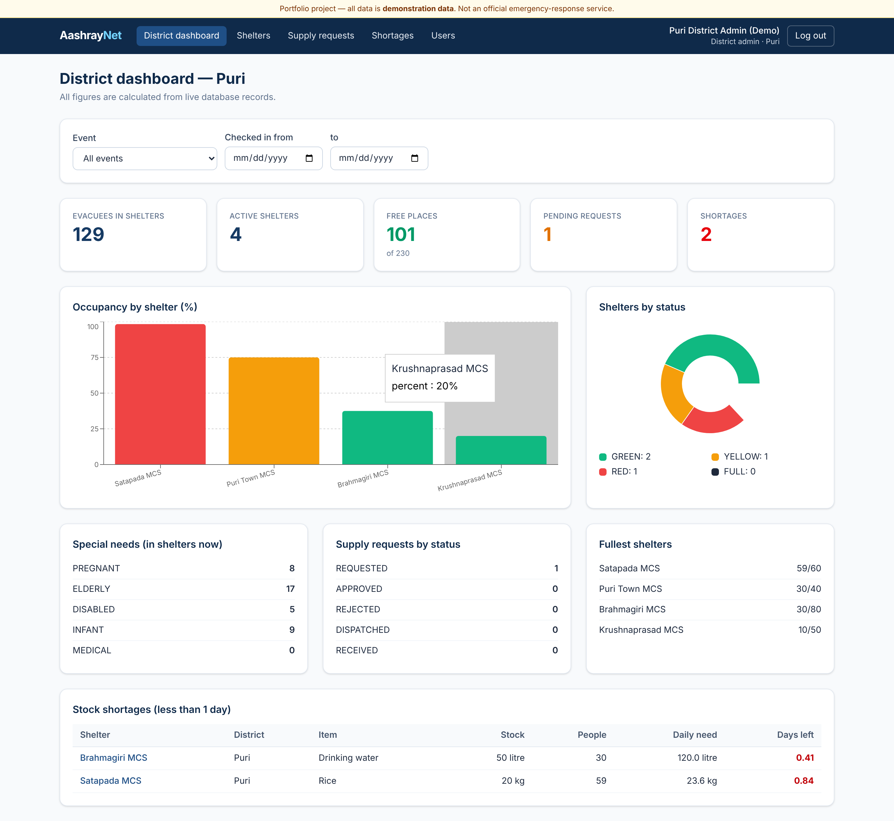
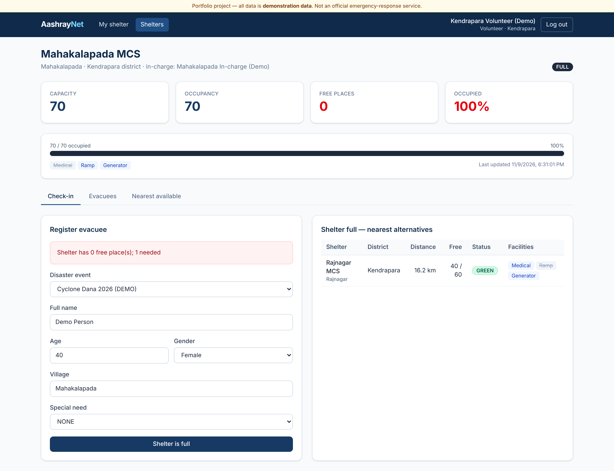
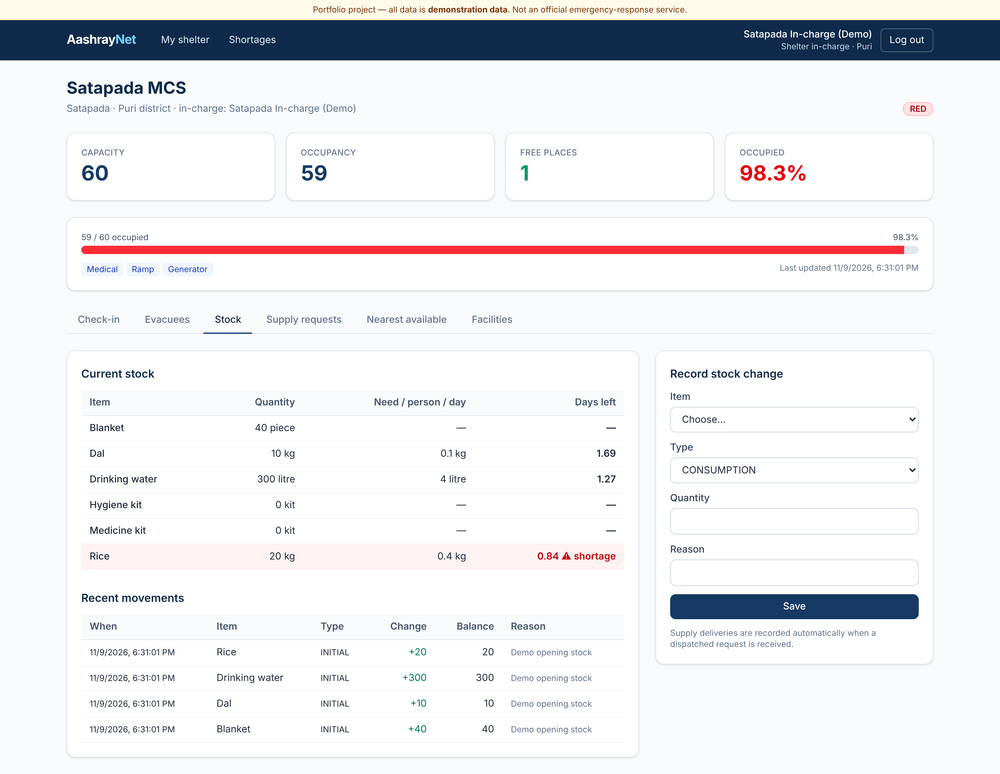
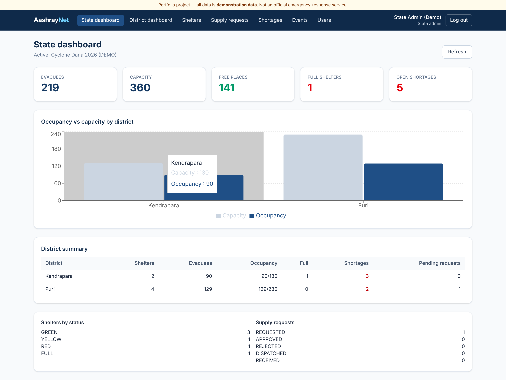
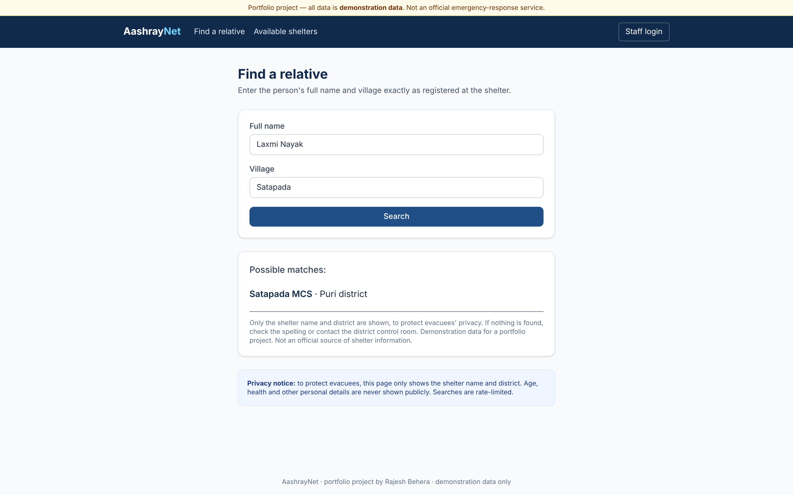
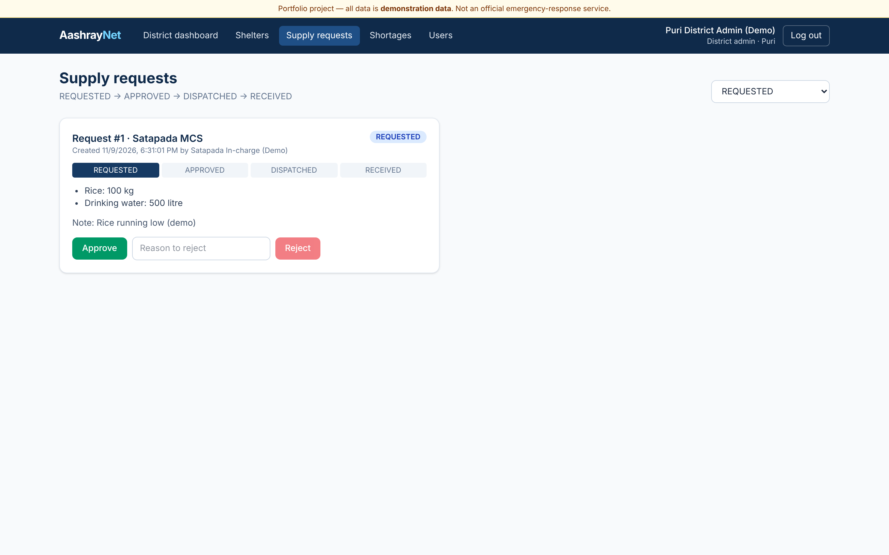
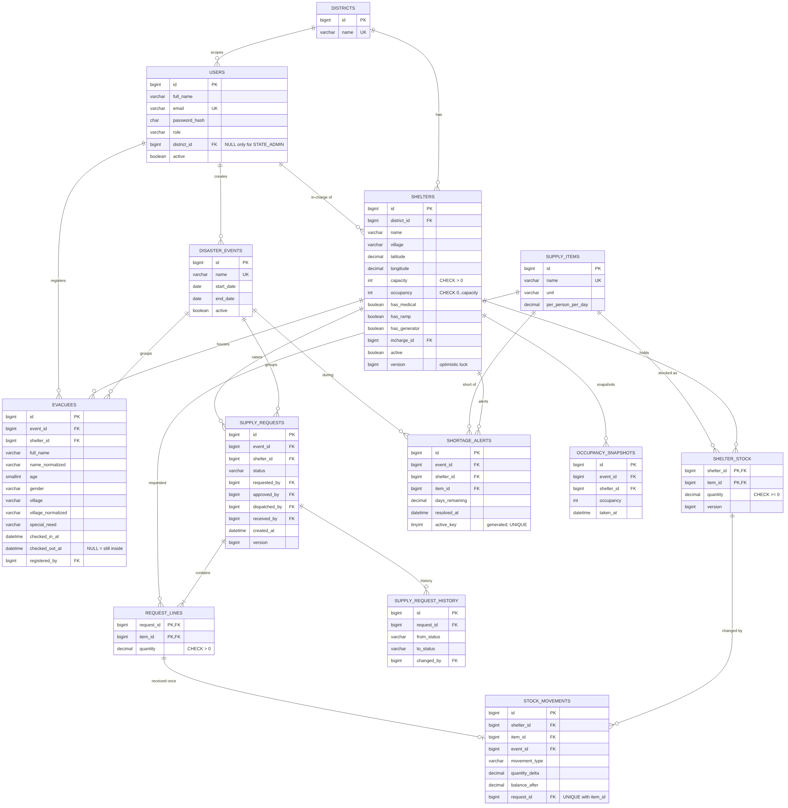

# AashrayNet — Cyclone Shelter & Relief Management System

> **Portfolio project. All data is demonstration data. This is not an official emergency-response service.**

AashrayNet helps coordinate cyclone shelters in Odisha:
- live shelter occupancy
- evacuee check-in and check-out
- nearest available shelter when one is full
- relief supply requests, approval, dispatch and receipt
- stock tracking with automatic shortage alerts
- a privacy-safe public family finder

Demo event: **Cyclone Dana 2026 (DEMO)**.

## Problem

During a cyclone, shelter occupancy, supply needs and "where is my family?" questions are handled on paper and by phone. District teams can't see which shelters are full or which will run out of rice tomorrow. AashrayNet puts that information in one place, with strict role- and district-based access.

## Status

| Part | State |
|---|---|
| Backend build (`mvn verify`) | ✅ BUILD SUCCESS |
| Tests | ✅ **68 / 68 passed** (52 unit/Mockito + 16 integration on real MySQL 8), concurrency test 5/5 |
| Coverage | **90.0 %** overall, **96.7 %** service layer (JaCoCo) |
| Frontend | ✅ lint + production build |
| Docker Compose | ✅ stack ran healthy; screenshots taken from it |
| Live deployment | ⬜ not deployed (no URL claimed) |

## Screenshots

| | |
|---|---|
|  District dashboard |  Full shelter → nearest alternatives |
|  In-charge stock & days left |  State dashboard |
|  Public family finder |  Supply request workflow |

More in [docs/screenshots](docs/screenshots).

## Features

- **Roles:** volunteer, shelter in-charge, district admin, state admin, plus public pages. Every rule is enforced in the backend; out-of-district records return 404.
- **Live occupancy:** GREEN < 70 %, YELLOW 70–90 %, RED > 90 %, FULL at capacity.
- **Concurrency-safe check-in:** `@Version` optimistic lock + retry + DB `CHECK`. Two volunteers can never take the last bed twice.
- **Nearest available shelter:** SQL bounding box + Haversine distance. Shelters without enough free places are excluded.
- **Supply workflow:** REQUESTED → APPROVED → DISPATCHED → RECEIVED (or REJECTED). Stock is updated **exactly once**.
- **Shortage detection:** `days = stock / (occupancy × daily need)`, below 1 day = shortage. Runs hourly and never duplicates alerts.
- **Public family finder:** returns only shelter name + district. Rate-limited, with a privacy notice.
- **Dashboards:** district and state, all from database queries, with charts.

## Technology

| Area | Stack |
|---|---|
| Backend | Java 21, Spring Boot 3.5.16, Spring MVC, Spring Data JPA, Hibernate, Spring Security, JWT (jjwt 0.12), Bean Validation, Spring Scheduling, springdoc OpenAPI |
| Database | MySQL 8 (8.4 in Docker), Flyway |
| Frontend | React 19, TypeScript, Vite 6, React Router 7, Tailwind CSS 4, Axios, Recharts |
| Testing | JUnit 5, Mockito, Spring Boot Test, MockMvc, Testcontainers, JaCoCo, Postman |
| DevOps | Maven, Docker, Docker Compose, Nginx, GitHub Actions |

## Architecture

```
React SPA ──► Nginx (static files, /api proxy, security headers) ──► Spring Boot ──► MySQL 8
                                             controller → service → repository
                                             JWT filter + AccessPolicy (role + district)
                                             schedulers: shortage check, snapshots
```



Details:
- [architecture](docs/architecture.md)
- [database design](docs/database-design.md)
- [ER diagram](docs/ER-diagram.md)
- [API](docs/api-documentation.md)

## Algorithms

- Occupancy and capacity locking: [docs/occupancy-and-capacity.md](docs/occupancy-and-capacity.md)
- Nearest shelter (Haversine): [docs/nearest-shelter-algorithm.md](docs/nearest-shelter-algorithm.md)
- Shortage formula: [docs/shortage-calculation.md](docs/shortage-calculation.md)
- Supply workflow: [docs/supply-workflow.md](docs/supply-workflow.md)

## Security

BCrypt passwords, JWT with logout revocation, `@PreAuthorize` and district scoping, no public sign-up, a minimal public DTO, rate limiting, safe errors, no personal data in logs, and secrets only via environment variables. See [docs/security-and-privacy.md](docs/security-and-privacy.md).

## Run locally

```bash
cp .env.example .env          # set passwords and JWT_SECRET (openssl rand -base64 48)
docker compose up --build
```

- Open http://localhost:8081
- Swagger: http://localhost:8081/swagger-ui.html

Without Docker: see [docs/deployment.md](docs/deployment.md).

**Demo credentials (dev profile only):** password `Demo@1234`. Accounts:
- `state@aashraynet.demo`
- `puri.admin@aashraynet.demo`
- `satapada.incharge@aashraynet.demo`
- `puri.volunteer@aashraynet.demo`

The full list is in [docs/user-guide.md](docs/user-guide.md).

## Tests

```bash
cd backend && mvn verify      # unit + Mockito + Testcontainers (Docker needed) + JaCoCo
cd frontend && npm ci && npm run lint && npm run build
```

Postman collection: `postman/AashrayNet.postman_collection.json` (29 requests). Results and honest status: [docs/testing.md](docs/testing.md).

## Learning and interviews

- [docs/code-walkthrough.md](docs/code-walkthrough.md): every important class explained
- [docs/interview-preparation.md](docs/interview-preparation.md)

## Known limitations

- Not deployed yet. A free single-VM deployment is described in docs/deployment.md.
- The rate limiter is in-memory (single instance).
- Distances are straight-line, not road distance.
- The family finder uses exact (normalised) matching only, on purpose for privacy.
- Demonstration data only.

## Future scope

- Leaflet/OpenStreetMap shelter map
- Odia and Hindi UI
- offline check-in with sync
- PDF/Excel post-cyclone report
- volunteer duty roster

## License

MIT, © 2026 Rajesh Behera
