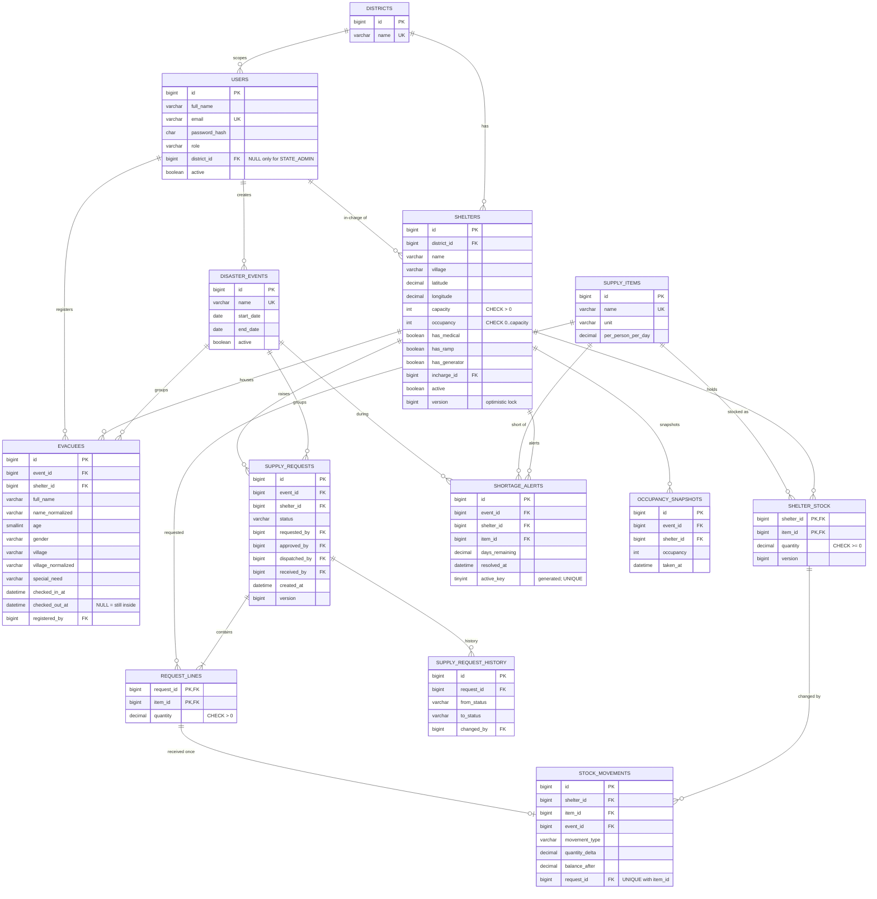

# AashrayNet — ER Diagram

Source of truth: `backend/src/main/resources/db/migration/V1__init_schema.sql`.
Audit fields (`created_at`, `updated_at`) are left out of the diagram to keep it readable.

Supporting tables not drawn: `revoked_tokens` (JWT logout) and `audit_logs`.
